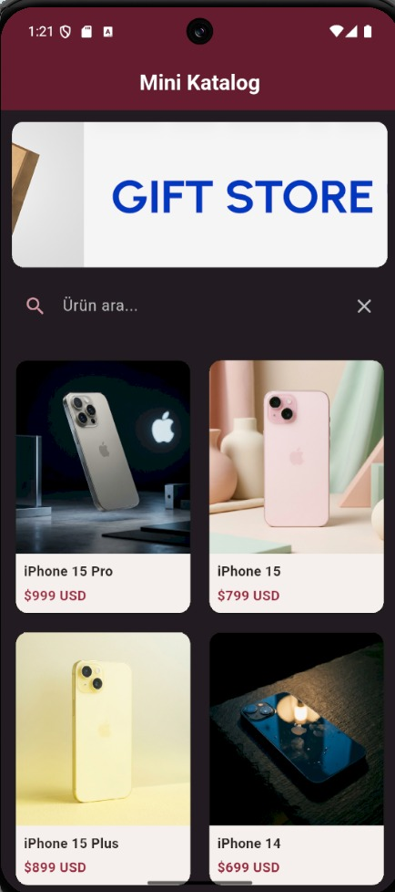
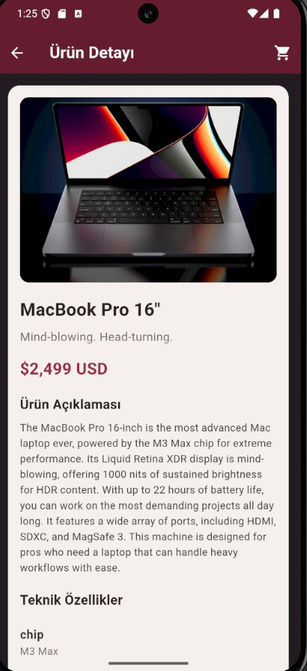
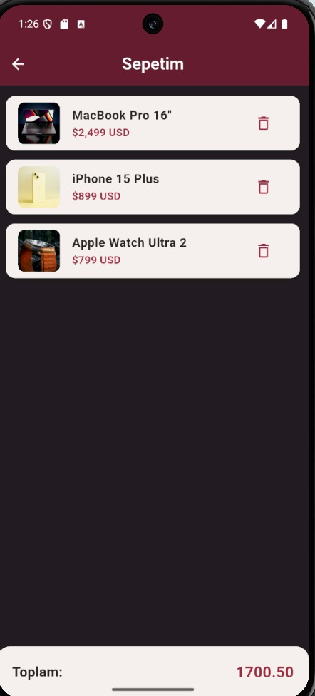

# Mini Katalog Uygulaması

## Proje Hakkında

Mini Katalog, Flutter ve Dart kullanılarak geliştirilmiş bir Android ürün katalog uygulamasıdır. Kullanıcılar ürünleri inceleyebilir, ürün detaylarını görüntüleyebilir, arama yapabilir ve beğendikleri ürünleri sepete ekleyebilir.

## Özellikler

- API üzerinden ürünleri listeleme (WantAPI).
- Ürünleri GridView ile görüntüleme.
- Ürün adına göre arama ve filtreleme.
- Ürün detay sayfası.
- Ürünleri sepete ekleme ve sepetten çıkarma.
- Sepet toplam tutarını hesaplama.
- Yerel JSON dosyasından ürün verisi okuma.
- JSON verilerini Product modeline dönüştürme.
- Sayfalar arası gezinme.

## Kullanılan Teknolojiler

- Flutter 3.47.9
- Dart 3.13.7
- Material Design
- REST API
- JSON

## Proje Klasör Yapısı

```text
mini_katalog/
├── assets/
│   ├── data/
│   │   └── sample_products.json
│   └── images/
│       └── banner.png
├── lib/
│   ├── models/
│   │   └── product.dart
│   ├── screens/
│   │   ├── home_screen.dart
│   │   ├── product_detail_screen.dart
│   │   └── cart_screen.dart
│   ├── services/
│   │   ├── product_service.dart
│   │   └── cart_service.dart
│   └── main.dart
├── android/
├── pubspec.yaml
└── README.md
```

## API ve Veri Kaynağı

Ürün verileri WantAPI üzerinden alınmaktadır.

API adresi: https://wantapi.com/products.php

Ayrıca JSON okuma işlemini göstermek amacıyla `assets/data/sample_products.json` dosyası kullanılmaktadır.

## Kurulum ve Çalıştırma

Projeyi bilgisayarınıza indirdikten sonra terminal üzerinden proje klasörüne girin.

Bağımlılıkları yükleyin:

```bash
flutter pub get
```
Android Studio üzerinden bir Android Emulator başlatın.
Uygulamayı çalıştırın:

```bash
flutter run
```

Uygulamanın çalışması için bilgisayarınızda Flutter SDK ve Android SDK kurulu olmalı; Android emülatörü veya fiziksel cihaz bağlı olmalıdır. API üzerinden ürün yüklemek için internet bağlantısı gereklidir.

## Geliştirici

Begüm Ülgen


## Ekran Görüntüleri

### Ana Sayfa


### Ürün Detay Sayfası


### Sepet Sayfası

